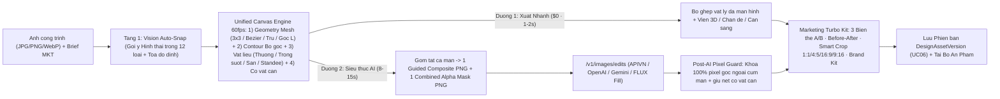

# Đề xuất Nâng cấp Toàn diện Tính năng Gắn Màn Hình LED tại Module 05 (`ToanTrung AI Studio` — Phiên bản V3 Chuẩn Kỹ Sư LED + Marketing Turbo Kit)

**Phân hệ:** `05-ai-design` — Hỗ trợ Thiết kế & Phối cảnh AI (UC06)  
**Phiên bản đề xuất:** **V3 — Universal LED Geometry Engine (12 Hình thái Thực tế) + 1-Chạm Không Cần Biết AI + Marketing Turbo Kit**  
**Ngày cập nhật:** 21/11/2026  
**Tài liệu tham chiếu:** [05-ai-design.md](./05-ai-design.md) · [05-ai-provider-comparison.md](./05-ai-provider-comparison.md) · [Handoff M05](../handoffs/05-ai-design.md) · [PERMISSIONS.md](../PERMISSIONS.md) · [MODULE_MAP.md](../MODULE_MAP.md) · [DATA_SAFETY.md](../DATA_SAFETY.md) · [OPEN_QUESTIONS.md](../decisions/OPEN_QUESTIONS.md)

---

## 1. Tóm tắt Điều hành V3 (Chuẩn Thực tế Kỹ sư Thi công LED + Tối Đa Hóa Cho Team MKT)

### Điểm thay đổi mang tính quyết định từ V2 lên V3
Thực tế kỹ sư thi công của Toàn Trung triển khai rất nhiều dòng **Màn hình LED kiến trúc & sáng tạo (Creative LED)** chứ không chỉ có khung 4 góc vuông phẳng: từ **góc bo tròn**, **cổng vòm**, **hình tròn / elip**, **đa giác N điểm né cột hoặc cửa sổ**, **màn uốn cong / uốn sóng chữ S-U**, **góc bo tròn 3D Naked-Eye**, **bọc cột trụ 360°**, **LED trong suốt gắn vách kính**, **LED sàn / LED trần**, **Standee LED chân đứng GOB**, đến **tổ hợp 3–5 màn sân khấu đồng thời**.

Bản **V3** hợp nhất toàn bộ thực tế thi công này vào một **Universal LED Geometry & Material Engine**, nhưng vẫn giữ nguyên sự đơn giản cho người không biết dùng AI và tốc độ sản xuất ấn phẩm cho Team Marketing:
1. **Đủ 12 hình thái LED thực tế trong 1 khung công cụ:** Chọn bằng **biểu tượng hình minh họa trực quan** (Phẳng, Bo góc tròn, Tròn/Oval, Tự vẽ N điểm bo góc, Cong, Góc L / Bo 3D, Bọc cột 360°, Uốn sóng, Trong suốt, Sàn/Trần, Standee, Sân khấu nhiều màn) — không cần học phần mềm 3D.
2. **Chỉ 1 chạm vẫn bắt đúng vị trí & tự đoán loại màn:** Chạm **1 điểm** vào cột tròn, vách kính, bức tường hay hành lang → Vision AI tự nhận diện đúng **hình thái màn LED + 4/N điểm tọa độ phối cảnh**.
3. **Giảm `85%–90%` công thủ công cho Team MKT (`Marketing Turbo Kit`):** Chạm xong 1 lần → sinh ngay **Bộ 3 biến thể A/B Test**, **Ảnh Trước/Sau**, **Xuất đủ 5 khổ kênh (`Gốc`, `1:1`, `4:5`, `16:9`, `9:16`)** có gắn Logo/CTA theo Brief và tự lấy tâm toàn bộ cụm màn LED.

### So sánh Toàn Diện (Hiện trạng vs Bản V3)

| Tiêu chí | Hiện trạng hiện tại | Bản V3 Đề xuất (Chuẩn Kỹ sư + MKT) |
| :--- | :--- | :--- |
| **Hình thái màn LED hỗ trợ** | Cứng `QuadCoordinatesDto` (4 góc phẳng) + `curved` mô phỏng sin nhẹ | **12 hình thái đầy đủ** trong 4 nhóm kỹ thuật + hỗ trợ lắp **nhiều màn hình (`screens[]`) trong cùng 1 ảnh** |
| **Số bước để ra ảnh lắp LED** | 7–9 bước, phải viết `@taoanh` + prompt mô tả + chọn đúng image model | **3 bước (~30 giây)**: `1. Chọn ảnh → 2. Chọn kiểu & 1 chạm chỗ lắp → 3. Chọn mẫu & Xuất bộ MKT` |
| **Độ chính xác vị trí & vật cản** | Cloud AI chưa nhận `mask`, chưa có cọ giữ bục/cây phía trước | **Homography `3×3` + Guided Composite + Alpha Mask đa hình thái + Post-AI Pixel Guard + Cọ vật cản** |
| **Ảnh điện thoại JPEG / WebP** | Server `decodePngToRgb` mới đọc được PNG 8-bit | **Hỗ trợ 100% JPEG / PNG / WebP** (tự chuẩn hóa hướng EXIF điện thoại, không cần C++ addon) |
| **Thời gian làm trọn bộ MKT (A/B + Before/After + 5 khổ)** | **48–90 phút** (M05 cũ + Photoshop + Canva) | **2–4 phút** ngay trong 1 màn hình (**giảm ~85–90% thao tác thủ công**) |

---

## 2. Chẩn đoán 6 Điểm nghẽn Thực tế (Từ Mã nguồn & Hiện trường Kỹ sư LED)

Qua đối chiếu trực tiếp mã nguồn Module 05 ([service.ts](../../apps/api/src/modules/05-ai-design/service.ts), [perspective-compositor.ts](../../apps/api/src/modules/05-ai-design/perspective-compositor.ts), [universal-cloud.provider.ts](../../apps/api/src/modules/05-ai-design/providers/universal-cloud.provider.ts), [openai-image.provider.ts](../../apps/api/src/modules/05-ai-design/providers/openai-image.provider.ts), [AiDesignWorkspace.tsx](../../apps/web/src/modules/05-ai-design/AiDesignWorkspace.tsx), [command-router.ts](../../apps/api/src/modules/05-ai-design/command-router.ts), [packages/contracts/src/05-ai-design/index.ts](../../packages/contracts/src/05-ai-design/index.ts)):

1. **Mô hình hình học hiện tại bị bó cứng ở `4 góc phẳng`:**
   - Hợp đồng `QuadCoordinatesDto` chỉ lưu 4 điểm `{ topLeft, topRight, bottomRight, bottomLeft }`, còn `screenStyle` mới chỉ nhận `'flat' | 'curved' | 'corner_90'`.
   - Trong [perspective-compositor.ts](../../apps/api/src/modules/05-ai-design/perspective-compositor.ts), `curved` mới cộng thêm độ võng sóng sin nhẹ (`0.035`), còn `corner_90` chưa tách 2 mặt phẳng; chưa hỗ trợ màn **góc bo tròn (`R-corner`)**, **hình tròn/elip**, **đa giác N điểm bo góc/né cột dầm**, **bọc cột trụ 360°**, **uốn sóng S/U**, **LED trong suốt vách kính**, **LED sàn/trần**, **Standee chân đứng GOB**, hay **tổ hợp nhiều màn hình trong cùng 1 ảnh**.
2. **Cloud AI chưa nhận được khóa hình học (`mask`) & bản mồi (`guided composite`):**
   - Trong [universal-cloud.provider.ts](../../apps/api/src/modules/05-ai-design/providers/universal-cloud.provider.ts) và [openai-image.provider.ts](../../apps/api/src/modules/05-ai-design/providers/openai-image.provider.ts), luồng `/v1/images/edits` chỉ gửi ảnh gốc + text prompt, chưa gửi kèm trường `mask` PNG RGBA.
3. **Bộ ghép nội bộ mới đọc được PNG 8-bit & dùng Inverse Bilinear:**
   - `decodePngToRgb` trong [perspective-compositor.ts](../../apps/api/src/modules/05-ai-design/perspective-compositor.ts) từ chối JPEG/WebP điện thoại; `renderRealPhotoAiCompositeBase64` trong [AiDesignWorkspace.tsx](../../apps/web/src/modules/05-ai-design/AiDesignWorkspace.tsx) căng ảnh chữ nhật `ctx.drawImage(productImg, minX, minY, boxW, boxH)` thay vì bẻ xạ ảnh `3×3` thật.
4. **Chưa tự chuẩn hóa thứ tự điểm & thiếu xử lý vật cản tiền cảnh:**
   - `syncQuadFromTouchPoints` gán cứng `pts[0..3]` → dễ bị xoắn chéo nếu user chấm ngược chiều; thiếu cọ đưa bục phát biểu, bàn họp, chậu cây, cột nhà hoặc người đứng trước màn LED nổi lên trên.
5. **Rào cản thao tác quá cao với người không biết AI & thiếu kho mẫu 1 chạm:**
   - Phải bật nút chấm điểm, nhớ `@taoanh`, tự chọn model, tự viết prompt (bị [command-router.ts](../../apps/api/src/modules/05-ai-design/command-router.ts) chặn lại hỏi thêm thông số kỹ thuật nếu chỉ trò chuyện tự nhiên).
6. **Nút thắt hậu kỳ của Team Marketing:**
   - Phải rời M05 ra Canva/Photoshop để tự làm ảnh Trước–Sau, gắn Logo/CTA từng website, cắt 4–5 khổ Ads (`1:1`, `4:5`, `16:9`, `9:16`) và lặp lại từ đầu nếu cần 3 biến thể A/B Test.

---

## 3. Danh Mục 12 Hình Thái Màn Hình LED Thực Tế (4 Nhóm Kỹ Thuật Toàn Trung)

Thay vì ép mọi công trình vào khung 4 góc cứng, V3 hỗ trợ **đầy đủ 12 hình thái thực tế** mà kỹ sư LED hay lắp, chia thành 4 nhóm trực quan với thanh chọn nhanh bằng hình minh họa:

### Nhóm A — Màn Phẳng & Hình Dạng Sáng Tạo (`Planar & Custom Cutouts`)

| # | Hình thái màn LED | Ứng dụng thi công thực tế | Cách thao tác cho người không biết AI | Thuật toán dựng hình & vật lý |
| :---: | :--- | :--- | :--- | :--- |
| **1** | **Phẳng 4 góc tiêu chuẩn** (`flat_rect`) | Phòng họp, hội trường, biển hiệu, mặt dựng phẳng | Chạm 1 điểm vào tường hoặc kéo 4 góc `A–B–C–D` (tự động sắp thứ tự chống xoắn) | Ma trận **Projective Homography `3×3`** + Supersampling `2×2` khử răng cưa |
| **2** | **Phẳng Bo Góc Tròn / Mái Vòm** (`rounded_rect` / `arch`) | Sảnh lễ tân sang trọng, showroom mỹ phẩm/ô tô, vòm cửa, màn trang trí bo `R` | Kéo 4 góc định khung + trượt 1 thanh **"Độ bo góc (`0%–40%`)"** (hoặc bật nhanh chế độ **"Bo 2 góc trên thành Mái Vòm Arch"**) | Nội dung warp theo Homography `3×3`, đường viền cắt tạo cung tròn `bezier/arc` trong không gian tọa độ UV rồi chiếu sang phối cảnh nghiêng + chạy viền nhôm uốn cong quanh góc bo |
| **3** | **Hình Tròn / Elip / Ô-van** (`circle_oval`) | Màn logo trung tâm thương mại, sân khấu tiệc cưới, bar/lounge, mặt tiền thương hiệu | Chọn biểu tượng **"Tròn / Oval"**, chạm vào tường để đặt khung bao 4 góc → tự biến thành hình tròn/elip đúng góc nghiêng của bức tường | Chiếu hình tròn nội tiếp không gian chuẩn `(0..1)²` qua ma trận Homography `3×3` → tự động ra đúng **Elip phối cảnh nghiêng**, kèm viền tròn CNC 3D |
| **4** | **Đa Giác Tự Do `N` Đỉnh Bo Góc** (`free_polygon`, `3–24` đỉnh) | Màn chữ L phẳng né khung cửa, hình chữ T sân khấu, bậc thang, lục giác, vách vát chéo ôm dầm cột | Bấm chấm liên tiếp `3` đến `24` đỉnh bao quanh mảng tường cần lắp (nhấn đúp hoặc bấm Đóng khung), kéo thanh **"Bo tròn các góc (`0–40 px`)"** hoặc bấm vào 1 đỉnh để bo/tắt bo góc riêng | Tách 2 lớp độc lập: **(1) Mặt phẳng xạ ảnh UV chung** (giữ chữ/ảnh thẳng thớm không bao giờ méo), và **(2) Đường cắt đa giác `N` đỉnh bo tròn `Quadratic Bezier` ở từng góc** + chạy viền khung bảo vệ dọc toàn bộ chu vi |

### Nhóm B — Màn Cong, Bo Góc 3D & Bọc Cột (`Flexible Module & Architectural LED`)

| # | Hình thái màn LED | Ứng dụng thi công thực tế | Cách thao tác cho người không biết AI | Thuật toán dựng hình & vật lý |
| :---: | :--- | :--- | :--- | :--- |
| **5** | **Cong Lồi / Cong Lõm 1 Chiều** (`curved_arc`) | Module LED dẻo uốn theo sảnh bán nguyệt, phòng họp lớn, showroom cao cấp | Kéo 4 góc chính + kéo **2 tay cầm mũi tên ở giữa cạnh trên & cạnh dưới** để uốn cong lồi hoặc lõm khớp mặt tường | Nội suy **Bezier bậc 2** ở biên trên & biên dưới, chia chiều ngang thành `16–24` dải cột nhỏ áp Homography từng dải + tạo độ cong sáng bóng theo mặt vòm |
| **6** | **Góc Vuông 90° & Bo Tròn 3D Naked-Eye** (`corner_90_smooth`) | Mặt tiền góc ngã tư tòa nhà (quảng cáo LED 3D không kính), sảnh góc trụ vuông bo mép | Kéo **6 điểm** (mặt trái + mặt phải chung 2 đỉnh trục đứng bản lề giữa) + trượt **"Bo góc giữa (`0%` gập sắc 90° ↔ `15–40%` bo cong 3D mượt)"** | Khi `cornerBlend = 0%`: giải 2 ma trận Homography trái/phải chia tỷ lệ nội dung liên tục tại trục bản lề; khi `> 0%`: tự bo đoạn chuyển tiếp 25% quanh trục bản lề bằng lưới dải trụ bo mượt + đổ bóng nhẹ ở góc gập |
| **7** | **Bọc Cột Trụ Tròn 360°** (`cylindrical_column`) | Cột kết cấu trung tâm thương mại (Lotte Mart, AEON), sảnh sân bay, khách sạn | Chọn biểu tượng **"Cột trụ"**, chạm 1 điểm lên thân cột → khung tự ôm trục đứng cột; trượt thanh **"Độ cong theo góc nhìn camera"** khớp mép đỉnh/đáy cột | Ánh xạ **Hình trụ 3D (`sin(θ)` nén ngang 2 bên rìa + độ võng elip cạnh trên/đáy)** kết hợp **Cylindrical Cosine Shading** (làm tối nhẹ `15%–25%` ở hai mép cong rìa trái/phải) giúp cột trông tròn nổi khối 3D cực thật |
| **8** | **Dải Màn Uốn Sóng / Chữ S / Chữ U** (`multi_segment_wave`) | Đường hầm ánh sáng, quầy bar/showroom thời trang, biển LED ticker chạy dài quanh sảnh | Chạm liên tiếp các điểm đỉnh/đáy dọc theo đường lượn sóng trên ảnh (hoặc chọn mẫu *"Uốn sóng 2 nhịp"*) | Nối nhiều đoạn Spline/Bezier mượt thành lưới `24–36` lát dọc, nội dung chạy liền mạch không đứt gãy qua từng khúc uốn |

### Nhóm C — Màn Vật Liệu & Không Gian Đặc Biệt (`Material & Spatial LED`)

| # | Hình thái màn LED | Ứng dụng thi công thực tế | Cách thao tác cho người không biết AI | Thuật toán dựng hình & vật lý |
| :---: | :--- | :--- | :--- | :--- |
| **9** | **Màn LED Trong Suốt / LED Lưới** (`transparent_glass`) | Lắp áp sau **vách kính mặt tiền showroom, cửa hàng trang sức/thời trang, giếng trời TTTM** (độ xuyên sáng `60%–85%`) | Chọn chất liệu **"Trong suốt qua kính"** + kéo thanh **"Độ xuyên sáng (`40%–85%`)"** | Dùng phép hòa trộn quang học **Luma-Key / Additive Screen Blending**: nền tối trong nội dung tự động biến thành **trong suốt để nhìn xuyên thấy quầy kệ/người bên trong kính**, chỉ các điểm LED sáng mới phát sáng rực, kèm sọc thanh lưới LED ngang mảnh & bóng phản chiếu vách kính |
| **10** | **Màn LED Sàn & Màn LED Trần** (`led_floor` / `led_ceiling`) | Sân khấu sàn catwalk chịu lực (kính cường lực chống trượt), sàn tương tác tiệc cưới; trần vòm bầu trời kỹ thuật số nhà hàng/karaoke/bar | Chạm 1 điểm trên mặt sàn hoặc trần nhà (nên kết hợp chọn chế độ **Sàn / Trần**); tự động tính phối cảnh nằm ngang cực gắt | Homography `3×3` cho mặt phẳng ngang + nếu là `led_floor`: phủ lớp **kính cường lực phản chiếu mờ + hiệu ứng bóng/đèn sân khấu + giữ nguyên chân người/đạo cụ bằng Cọ vật cản**; nếu là `led_ceiling`: tự giảm hắt sáng xuống, ưu tiên hòa hợp ánh đèn trần |

### Nhóm D — Màn Độc Lập & Tổ Hợp Nhiều Màn Trong 1 Ảnh (`Multi-Screen Scene`)

| # | Hình thái màn LED | Ứng dụng thi công thực tế | Cách thao tác cho người không biết AI | Thuật toán dựng hình & vật lý |
| :---: | :--- | :--- | :--- | :--- |
| **11** | **Standee LED / Poster LED Chân Đứng** (`led_standee`) | Standee LED GOB đặt ở sảnh chờ, hành lang ga Metro, lối vào hội nghị/showroom | Chọn **"Standee LED đứng"**, chạm **1 điểm trên mặt sàn** chỗ muốn đặt → tự sinh khung LED đứng tỷ lệ chuẩn (`640×1920mm`), có sẵn **chân đế thép đứng vững + bóng đổ dưới sàn**; hỗ trợ nút **"+ Nhân bản thành dãy 2–3 cây"** | Homography khớp trục thẳng đứng + render chân đế kim loại sơn tĩnh điện đen ở cạnh đáy + **Drop Shadow tiếp xúc mặt sàn (`Contact Shadow`)** để cây Standee đứng vững tự nhiên, không bị "bay lơ lửng" |
| **12** | **Tổ Hợp Nhiều Màn Hình (`Multi-Screen`)** (`multi_screen_stage`) | Sân khấu sự kiện gồm **1 Màn chính giữa + 2 Màn cánh gà**, hoặc **Chính + 2 Cánh + Trán (Header) + LED Sàn**, hoặc **2–3 Cột trụ / Standee** trong cùng 1 sảnh | Có nút **`"+ Thêm màn hình nữa"`** trong cùng 1 bức ảnh, hoặc chọn Preset 1 chạm: **"Sân khấu 3 màn"**, **"Sân khấu 5 màn"**, **"Hành lang 3 Standee"**. Chọn chạy **"Cùng 1 nội dung đồng bộ"** hoặc **"Mỗi màn 1 ảnh riêng"** | Quản lý dưới dạng mảng `screens: LedScreenInstanceDto[]` (`z-index` rõ ràng). Mỗi màn chọn hình thái riêng (VD: màn chính phẳng bo góc + 2 cánh gà cong + 1 màn sàn), cùng render lên chung 1 Canvas Live 60fps & gom chung thành 1 `Alpha Mask` duy nhất khi gọi Cloud AI |

---

## 4. Kiến trúc Unified Surface Mesh & Material Engine (Làm sao 12 Loại Vẫn Chạy Chung 1 Đường Đơn Giản?)

Điểm tinh túy nhất của bản **V3** là dù có tới **12 hình thái LED** và cho phép **nhiều màn trong 1 ảnh**, toàn bộ hệ thống không bị phình code hay rối giao diện vì dùng chung **4 Lớp Hợp Nhất (`Unified Pipeline`)**:



### Cách Tầng 1, Tầng 2 và Tầng 3 kết hợp mượt mà trên cả 12 hình thái

1. **Tầng 1 — Vision Auto-Snap thông minh hơn ("1 Chạm Đoán Luôn Loại Màn"):**
   - Khi người dùng chạm **1 điểm** trên ảnh (hoặc bấm *"✨ AI tự tìm vị trí lắp đẹp nhất"*), backend tạo ảnh mồi có chấm đỏ + thước tọa độ `0..100` và gửi Vision AI (`gemini-2.5-flash` / `gpt-4o`, `1.5–2.5s`, `~$0.001`).
   - Vision AI giờ đây nhận diện được cả bối cảnh hình học thực tế để đề xuất sẵn đúng loại màn trong 12 loại:
     - Chạm vào **thân cột bê tông tròn** → đề xuất `cylindrical_column` (tọa độ cột + độ cong trụ).
     - Chạm vào **vách kính showroom** → đề xuất `transparent_glass` (độ xuyên sáng `65%`).
     - Chạm vào **góc tường chữ L ngoài trời** → đề xuất `corner_90_smooth` (6 đỉnh khớp 2 mặt tường + trục đứng giữa).
     - Chạm vào **mảng tường bo cong** → đề xuất `curved_arc`.
     - Chạm vào **sàn hành lang trống** → đề xuất `led_standee` (chân đứng vừa tầm mắt).
     - Hoặc nếu chỉ muốn đổi sang **Bo góc tròn / Elip / Đa giác N điểm né cột**, người dùng chỉ việc bấm 1 icon ngay bên cạnh là khung hiện tại tự biến hình tức thì mà không phải chấm lại từ đầu!

2. **Tầng 2 — Chuẩn hóa đỉnh chống xoắn + Kính lúp `2.5x` + Hỗ trợ `100%` ảnh điện thoại:**
   - Thuật toán `canonicalizeQuad` chống xoắn cho tất cả khung 4 góc; tự động hỗ trợ thêm/xóa/bo tròn từng đỉnh trên khung `N` đỉnh (`free_polygon`); giải mã JPEG/PNG/WebP có EXIF trên trình duyệt, xuất Live Preview 60fps với kính lúp `2.5x`.
   - **Điểm đột phá khi gọi Cloud AI:** Dù người dùng lắp **màn bo góc tròn**, **màn elip**, **cột trụ 360°**, **LED trong suốt**, **đa giác 8 cạnh né cửa sổ**, hay **sân khấu 5 màn hình cùng lúc** — trình duyệt vẫn gộp tất cả thành **1 cặp PNG chuẩn duy nhất**:
     1. `Guided Composite PNG` (`image`): Ảnh công trình đã dựng sẵn toàn bộ các màn LED đúng hình dáng, độ cong, độ xuyên sáng, viền 3D / chân đế Standee.
     2. `Combined Alpha Mask PNG` (`mask`): Vùng trong suốt (`alpha = 0` + vòng feather `14–20px`) chỉ đúng vào hình dạng bo tròn / đa giác / cột trụ / các cụm màn và vùng hắt sáng; toàn bộ không gian còn lại `alpha = 255` khóa cứng kiến trúc.
     3. **Cloud AI Mask-Inpainting + Post-AI Pixel Guard:** Kết quả Cloud AI trả về được Pixel Guard lọc một lần nữa qua đúng hình mask + lớp **Cọ đưa vật cản tiền cảnh lên trước** → **khóa `0 px` sai lệch kiến trúc gốc**.

3. **Tầng 3 — Playbook 8+ Bối cảnh Toàn Trung & Kho Kinh Nghiệm Đã Duyệt:**
   - Bổ sung tri thức hòa sáng riêng cho **Cột trụ**, **Vách kính trong suốt**, **Góc tòa nhà Naked-Eye 3D**, **Sàn/Trần**, **Standee GOB** vào `led-placement-playbook.ts`.
   - Lưu ẩn danh kinh nghiệm (loại hình thái, độ bo góc, độ xuyên sáng, cách hòa sáng, mẫu prompt — **zero PII**) mỗi khi bản thiết kế được **Phê duyệt**.

---

## 5. Bộ Công Cụ Tăng Tốc Tối Đa Cho Team Marketing (`Marketing Turbo Kit` — Chạy Mượt Trên Mọi Hình Thái LED)

Toàn bộ **7 tính năng Marketing Turbo Kit** của V2 tương thích `100%` với cả 12 hình thái màn LED mới:

1. **Tự động nhận Brief từ Team MKT (`Brief-to-LED Auto-Fill`):**
   - Đọc `DesignBriefDto` (`websiteDomain`, `campaignName`, `headlineText`, `subheadlineText`, `ctaText`, `brandPrimaryColor`, `brandLogoMode`) từ `submit_marketing_brief` ([design/route.ts](../../apps/api/src/app/api/v1/design/route.ts)) → tự đổ màu, tiêu đề lên ruột màn LED (kể cả trên tổ hợp nhiều màn) và tự gắn thông tin cho bộ xuất Brand Kit.
2. **Sinh Bộ 3 Biến Thể A/B Test Chỉ Với 1 Lần Đặt Màn (`1-Click Multi-Variant Ads Pack`):**
   - Ví dụ đã đặt xong 1 màn bo góc tròn hoặc sân khấu 3 màn → bấm **`"⚡ Sinh bộ 3 biến thể A/B"`** → tự động tạo ngay 3 phiên bản hiển thị khác nhau (`v1`, `v2`, `v3`) giữ khít nguyên hình thái, độ bo góc, độ cong và nét cọ vật cản đã làm.
3. **Tạo Ảnh So Sánh Trước / Sau Trong 1 Giây (`1-Click Before–After Showcase`):**
   - Ghép tức thì ảnh công trình trống vs ảnh đã lắp màn LED (kể cả khi lắp nhiều màn hoặc Standee) theo 3 layout: **Trái/Phải**, **Trên/Dưới**, **Đường chéo** kèm nhãn sạch sẽ.
4. **Xuất Đủ 5 Khổ Kênh + Smart Focal Crop (`1:1`, `4:5`, `16:9`, `9:16`, `Gốc`) + Brand Kit:**
   - **Smart Focal Crop** tự động tính **hộp bao trọng tâm của tất cả các màn hình (`screens[]` union centroid)** → dù cắt sang ảnh vuông `1:1` (Facebook/GDN) hay dọc `9:16` (TikTok/Reels/Zalo) cũng **không bao giờ cắt mất mép bo tròn, cột trụ hay cánh gà sân khấu**.
   - Bật/tắt **Brand Kit Overlay** (Logo Toàn Trung sáng/tối + Website + Headline + CTA né cụm màn LED, đã lọc PII).
5. **Tách Bước "AI Vẽ Riêng Ruột Màn Hình" Từ 1 Dòng Chữ (`AI Screen Content Generator`):**
   - Đặc biệt hữu ích cho màn bo góc lớn, màn tròn/oval (cần bố cục logo tròn vào tâm), màn dài uốn sóng (`32:9`), hoặc màn **LED Trong Suốt** (yêu cầu nền đen sâu `pure black background` để vùng tối tự xuyên thấu qua kính, chỉ nổi họa tiết ánh sáng 3D rực rỡ!).
6. **Xử Lý Liên Tiếp Nhiều Góc Chụp Cùng 1 Công Trình (`Multi-Photo Quick Queue`):**
   - Đổi sang ảnh góc chụp khác trong cùng công trình → giữ nguyên mẫu nội dung, kiểu chất liệu (VD: cùng là LED trong suốt `65%`), độ bo góc, Brand Kit; chỉ cần 1 chạm đặt lại vị trí là xuất tiếp trong `10 giây`.
7. **Lưu Bộ Công Thức Riêng Của Team (`Saved Marketing Recipes`):**
   - Lưu các cấu hình hay dùng của team (VD: *"Case Study Standee GOB 4:5"*, *"Ads LED Trong Suốt Showroom 1:1"*, *"Naked-Eye 3D Bo Góc Trước/Sau"*).

---

## 6. Thiết kế Giao diện V3 ("Đủ 12 Hình Thái Trong Giao Diện 3 Bước Siêu Dễ")

```text
+----------------------------------------------------------------------------------------------------------+
| [🎯 Gắn Màn LED Nhanh & Xuất MKT]   [🎨 Studio AI Toàn diện]   [💬 Chat ToanTrung AI]   [⚙️ Thông số]   |
+----------------------------------------------------------------------------------------------------------+
| BƯỚC 1: Chọn ảnh công trình  ──►  BƯỚC 2: Chọn kiểu & Chỉ chỗ lắp  ──►  BƯỚC 3: Chọn mẫu & Xuất bộ MKT  |
+--------------------+-----------------------------------------------------+-------------------------------+
| KHO ẢNH CÔNG TRÌNH | KHUNG HÌNH XEM TRƯỚC TRỰC TIẾP (LIVE 60FPS)         | BẢNG ĐIỀU KHIỂN 3 BƯỚC       |
|                    |                                                     |                               |
| [✓ Sảnh TTTM]      |   +---------------------------------------------+   | BƯỚC 2: LOẠI MÀN & ĐỊNH VỊ    |
| [  Vách kính]      |   |                                             |   | Chọn kiểu màn (Icon trực quan):|
| [  Sân khấu]       |   |  [Ảnh công trình JPG/PNG/WebP]              |   | [▭ Phẳng] [▢ Bo góc] [◯ Tròn] |
| [+ Tải nhiều ảnh]  |   |     + Hỗ trợ Bo tròn / Oval / Đa giác N điểm|   | [⬠ Đa giác][◠ Cong] [◷ Góc 3D]|
|                    |   |     + Hỗ trợ Cột trụ / Uốn sóng / Trong suốt|   | [🛢 Cột trụ][∿ Sóng] [🪟 Kính] |
| CỤM MÀN TRONG ẢNH  |   |     + Kính lúp 2.5x + Nét cọ vật cản        |   | [⬓ Sàn/Trần][🧍Standee][🎭Nhiều]|
| • #1 Màn chính ✓   |   |                                             |   |                               |
| • #2 Cánh trái     |   +---------------------------------------------+   | [✨ AI tự đoán] [👆 1 chạm bắt]|
| [+ Thêm màn khác]  |                                                     | Bo góc: [==o--] Xuyên kính [o--]|
| [Preset Sân khấu]  |  [👁️ Xem gốc] [🔀 Trước/Sau] [↩️ Ctrl+Z] [🔍 2.5x]  |                               |
|                    |                                                     | BƯỚC 3: NỘI DUNG & XUẤT MKT   |
| LỊCH SỬ PHIÊN BẢN  |  TINH CHỈNH NHANH CHO MÀN ĐANG CHỌN:                | [16 Mẫu 1 chạm] [Tải ảnh SP]  |
| • v1 Nhanh ($0)    |  Sáng [====o--] Viền 3D [==o---] Lưới Diode [ ]     | [Gõ 1 dòng AI vẽ ruột LED]    |
| • v2 AI Siêu thực  |  Hắt sáng [✓] Phản chiếu sàn [ ] [🖌️ Cọ giữ bục/cây] | [⚡ Sinh bộ 3 biến thể A/B]    |
| • v3 Trước/Sau     |                                                     | [🔀 Trước/Sau] [1:1 4:5 16:9] |
|                    |                                                     | [⚡ XUẤT NHANH] [✨ AI SIÊU THỰC]|
+--------------------+-----------------------------------------------------+-------------------------------+
```

- **Quy tắc cho người mới:** Mặc định chỉ hiện 6 hình thái phổ biến nhất trên 1 hàng + nút **`"Xem thêm 6 loại (Cột trụ, Trong suốt, Sàn, Standee...)"`** để màn hình cực kỳ gọn gàng mà khi cần kỹ sư vẫn có đủ 100% đồ nghề!

---

## 7. Kiến trúc Mã nguồn & Hợp đồng API V3 (Gọn Trong Module 05 — Không Đổi Database Schema)

- **Phạm vi tuyệt đối trong Nhóm 5 (`05-ai-design`):** Tuân thủ [MODULE_MAP.md](../MODULE_MAP.md), không chỉnh sửa module 01–04 hay Core.
- **Không cần thêm bảng DB hay Migration mới:** Lưu cấu hình mảng `screens[]` (`LedScreenInstanceDto[]`) đầy đủ 12 hình thái, tham số bo góc, điểm cong Bezier, độ xuyên sáng, cọ vật cản, và Marketing Recipe vào cột `installPositionJson` trên `design_requests` và `parametersJson` trên `design_asset_versions` theo đúng mô hình hiện tại trong [service.ts](../../apps/api/src/modules/05-ai-design/service.ts).

### Cấu trúc dữ liệu lõi mới tại [packages/contracts/src/05-ai-design/index.ts](../../packages/contracts/src/05-ai-design/index.ts)
- Định nghĩa `LED_SCREEN_SHAPES` gồm 12 mã rõ ràng: `'flat_rect' | 'rounded_rect' | 'circle_oval' | 'free_polygon' | 'curved_arc' | 'corner_90_smooth' | 'cylindrical_column' | 'multi_segment_wave' | 'transparent_glass' | 'led_floor' | 'led_ceiling' | 'led_standee'`.
- Định nghĩa `LedScreenInstanceDto` cho phép lưu `1` hoặc **nhiều màn hình (`screens: LedScreenInstanceDto[]`) trong cùng 1 ảnh**, mỗi màn mang:
  - `shapeType`: thuộc 12 loại trên;
  - `quad` (tứ giác chính 4 góc `0..100%`) — luôn giữ tương thích ngược với `QuadCoordinatesDto` cũ;
  - `polygonPoints?`: mảng `3..24` điểm `{ x, y, cornerRadiusPct? }` cho `free_polygon`, bo từng góc (Arch), hoặc dải uốn sóng;
  - `secondaryQuad?` + `cornerRoundnessPct?`: cho màn **Góc 90° & Bo góc 3D Naked-Eye** (`corner_90_smooth`);
  - `curveSagTopPct?`, `curveSagBottomPct?`, `cylinderPerspectivePct?`: điều khiển độ cong lồi/lõm & độ ôm cột trụ;
  - `cornerRadiiPct`: `{ tl, tr, br, bl }` hỗ trợ bo tròn đều hoặc bo vòm (Arch);
  - `material`: `{ transparencyPct, lumaKeyThreshold, hasGlassReflection, floorGlassSpecular, cabinetGridStrength, bezelThicknessPx, brightnessPct, ambientSpillPct, hasStandeeBase }`;
  - `contentSource`: mẫu preset, ảnh từ Kho SP Cty, ảnh tải lên hoặc vùng cắt của nội dung đồng bộ nhiều màn.

### Danh sách tệp dự kiến tạo mới / nâng cấp

| Tệp mã nguồn | Hành động | Nhiệm vụ cụ thể trong bản V3 |
| :--- | :--- | :--- |
| [packages/contracts/src/05-ai-design/index.ts](../../packages/contracts/src/05-ai-design/index.ts) | Nâng cấp | Bổ sung `LED_SCREEN_SHAPES`, `LedScreenInstanceDto`, `AutoDetectLedPlacementRequestSchema` (trả luôn `recommendedShapeType`), `LedQuickInstallRequestSchema` (`screens[]`), `GenerateLedScreenContentRequestSchema`, `MarketingExportFormatDto`. |
| `apps/api/src/modules/05-ai-design/led-placement-playbook.ts` | **Tạo mới** | Playbook 8+ bối cảnh & 12 hình thái LED Toàn Trung (nhấn mạnh prompt nền đen thuần cho LED Trong suốt, bo góc 3D Naked-Eye, cột trụ, Standee chân đế, sân khấu nhiều màn) + Prompt Vision Auto-Snap + Vòng lưu kinh nghiệm đã duyệt. |
| `apps/api/src/modules/05-ai-design/led-homography.ts` | **Tạo mới** | Chuẩn hóa đỉnh chống xoắn `canonicalizeQuad` + sắp xếp đa giác lồi/không cắt chéo; giải **Projective Homography `3×3`**; dựng Alpha Mask PNG RGBA đa hình thái (bo tròn, oval, đa giác N điểm, nhiều màn) có vòng feather; `applyPostAiPixelGuard` khóa `100%` pixel gốc ngoài vùng chọn. |
| [perspective-compositor.ts](../../apps/api/src/modules/05-ai-design/perspective-compositor.ts) | Nâng cấp | Tích hợp `led-homography.ts` vào `renderPerspectiveCompositeWithProtection` thay thế inverse bilinear cũ. |
| [universal-cloud.provider.ts](../../apps/api/src/modules/05-ai-design/providers/universal-cloud.provider.ts) & [openai-image.provider.ts](../../apps/api/src/modules/05-ai-design/providers/openai-image.provider.ts) | Nâng cấp | Bổ sung `maskImageBuffer` gửi trường `mask` chuẩn multipart vào `/v1/images/edits` + fallback an toàn nếu gateway không nhận `mask`. |
| [service.ts](../../apps/api/src/modules/05-ai-design/service.ts) | Nâng cấp | Bổ sung `autoDetectLedPlacement` (1 chạm đoán cả loại màn trong 12 hình thái + tọa độ), `executeQuickLedInstall` (hỗ trợ đa màn + đa hình thái cho cả Fast Composite `$0` & Cloud AI Mask-Inpaint + Pixel Guard), `generateLedScreenContent` (hỗ trợ nền đen cho LED trong suốt / khung tròn cho Oval). |
| [design-id route](../../apps/api/src/app/api/v1/design/[id]/route.ts) | Nâng cấp nhẹ | Gắn 3 action `auto_detect_led_placement`, `quick_install_led`, `generate_led_screen_content` đi qua `assertCanAccessDesignProject` và quyền BA `AI_DESIGN`. |
| `apps/web/src/modules/05-ai-design/led-geometry-engine.ts` | **Tạo mới** | Bộ dựng hình học **Unified 12 Hình Thái 60fps** thuần Browser Canvas/2D (zero C++ addon): `Homography 3×3`, `Rounded-Rect / Arch`, `Perspective Ellipse`, `Free Polygon N đỉnh bo góc`, `Bezier Curved Mesh 16–24 lát`, `Corner 90° + Bo góc 3D`, `Cylindrical Column + Cosine Shading`, `Multi-Segment Wave`, `Transparent Glass Luma-Key`, `Floor/Ceiling`, `Standee + Chân đế + Contact Shadow`, `Multi-Screen Stage`, xuất cặp PNG (`GuidedComposite` + `CombinedAlphaMask`). |
| `apps/web/src/modules/05-ai-design/led-content-presets.ts` | **Tạo mới** | Kho 16+ mẫu hiển thị LED theo ngành hàng + mẫu thiết kế chuyên biệt nền đen nổi khối 3D cho LED Trong Suốt & mẫu tròn cho LED Oval/Cột trụ. |
| `apps/web/src/modules/05-ai-design/marketing-export-kit.ts` | **Tạo mới** | **Marketing Turbo Kit**: Brief Auto-Fill, 1-Click Trước/Sau (3 layout), 1-Click 3 Biến thể A/B, **Smart Focal Crop** theo hộp bao toàn bộ `screens[]` cho `1:1 / 4:5 / 16:9 / 9:16`, Brand Kit Overlay (chống đè màn LED, lọc PII). |
| `apps/web/src/modules/05-ai-design/LedQuickInstallWizard.tsx` | **Tạo mới** | Giao diện **3 Bước + Bảng chọn 12 Hình thái trực quan + Quản lý Nhiều màn hình (`screens[]`) + Kính lúp `2.5x` + Cọ vật cản + Thanh Marketing Turbo Kit**. |
| [AiDesignWorkspace.tsx](../../apps/web/src/modules/05-ai-design/AiDesignWorkspace.tsx) | Nâng cấp nhẹ | Gắn tab **`🎯 Gắn Màn LED Nhanh & MKT`** ngay thanh trên cùng, dùng chung Kho ảnh, Brief Marketing, Danh sách phiên bản, Tải HD & Phê duyệt. |

---

## 8. Ranh giới Phân quyền BA & Bảo mật ([PERMISSIONS.md](../PERMISSIONS.md))

1. **Ma trận BA hiện tại:** Quyền **`AI thiết kế: phối cảnh 3D và banner` (`AI_DESIGN`)** đang cấp cho **`DESIGNER`** và **`ADMIN`**; nhóm Marketing (**`MKT_STAFF`**, **`ADS`**, **`MKT_LEAD`**) hiện có quyền gửi Brief từ M03/M04 sang M05 (`submit_marketing_brief` tại [design/route.ts](../../apps/api/src/app/api/v1/design/route.ts)), chưa có dấu tick ở `AI_DESIGN` và `ATTACHMENT_UPLOAD_VIEW`.
2. **Cam kết tuân thủ trong code:** Backend không tự nới quyền trái ma trận BA. Với ma trận hiện hành, `DESIGNER`/`ADMIN` vận hành trực tiếp bộ V3 để xuất trọn bộ 12 hình thái + Marketing Turbo Kit cho team MKT nhanh gấp 10 lần; nếu muốn mở quyền trực tiếp cho `MKT_STAFF`/`MKT_LEAD` dùng riêng công cụ này (vẫn giữ nguyên quy tắc **ẩn danh Lead UC01**), cần xác nhận ghi vào [PERMISSIONS.md](../PERMISSIONS.md) và [OPEN_QUESTIONS.md](../decisions/OPEN_QUESTIONS.md).
3. **Zero PII & Minh bạch chi phí ([DATA_SAFETY.md](../DATA_SAFETY.md)):** Mọi prompt Vision/Image và chữ trên Brand Kit đều quét `containsCustomerPiiInPrompt`. Xuất Nhanh (`$0`) ghi `LOCAL_COMPOSITE`; Hòa sáng AI ghi log thực tế vào `ai_usage_logs`. Mọi phiên bản sinh ra đều ở trạng thái bản nháp để kiểm tra/Phê duyệt theo UC06.

---

## 9. Kế hoạch Triển khai 2 Đợt Gọn Gàng & Nghiệm thu

### Đợt 1 — Unified 12 Hình Thái Engine + 3 Bước Siêu Dễ + Lắp Nhanh (`$0`)
- Hoàn thiện hợp đồng `LedScreenInstanceDto` (`screens[]`), `led-homography.ts`, `led-placement-playbook.ts`, nâng cấp `perspective-compositor.ts` & `service.ts` (`autoDetectLedPlacement`, `quick_install_led` chế độ `fast_composite`).
- Xây dựng trọn bộ `led-geometry-engine.ts` hỗ trợ đầy đủ **12 hình thái** + quản lý nhiều màn hình + Preset Sân khấu 3 màn/5 màn + `led-content-presets.ts` + `LedQuickInstallWizard.tsx` (1-Click Vision Auto-Snap, Kính lúp `2.5x`, Cọ đưa vật cản tiền cảnh lên trước, Multi-Photo Queue).

### Đợt 2 — Cloud AI Mask-Inpainting + Toàn Bộ Marketing Turbo Kit + Kiểm thử
- Nâng cấp `universal-cloud.provider.ts` & `openai-image.provider.ts` gửi `mask` PNG đa hình thái + `Post-AI Pixel Guard` + `generate_led_screen_content` + `marketing-export-kit.ts` (Brief Auto-Fill, 1-Click 3 Biến thể A/B, Trước/Sau 3 layout, Smart Focal Crop `1:1 / 4:5 / 16:9 / 9:16`, Brand Kit Overlay) + tích hợp vào [AiDesignWorkspace.tsx](../../apps/web/src/modules/05-ai-design/AiDesignWorkspace.tsx).
- Kiểm thử: `npm run typecheck` toàn monorepo, unit test `node --test` (chuẩn hóa đỉnh, `Homography 3×3`, bo góc đa giác, `Alpha Mask` & `Pixel Guard` 0 px sai lệch ngoài vùng mask, lọc PII), và test trực tiếp trên trình duyệt `http://127.0.0.1:3000/design` với ảnh chụp JPEG điện thoại thực tế.

---

### Chốt 2 Ý Cuối Để Bắt Tay Vào Code Ngay
1. **Duyệt kiến trúc V3 (12 Hình thái Kỹ sư LED + Marketing Turbo Kit):** Bạn xác nhận bắt đầu triển khai code ngay trọn bộ **Đợt 1 + Đợt 2** theo đề xuất V3 này chứ?
2. **Quyền cho Team MKT thao tác trực tiếp:** Hiện tại theo [PERMISSIONS.md](../PERMISSIONS.md), `MKT_STAFF`/`MKT_LEAD`/`ADS` chỉ mới được gửi Brief sang M05 chứ chưa được mở nút dùng trực tiếp Studio thiết kế (chỉ `DESIGNER` và `ADMIN` mới bấm được). Bạn muốn **giữ nguyên quyền BA hiện tại**, hay muốn **mình đề xuất mở bổ sung quyền riêng cho `MKT_STAFF`/`MKT_LEAD` được trực tiếp vào tab "Gắn Màn LED Nhanh & Xuất MKT"** (khi mở sẽ vẫn ẩn SĐT/tên khách hàng của Lead theo UC01)?
